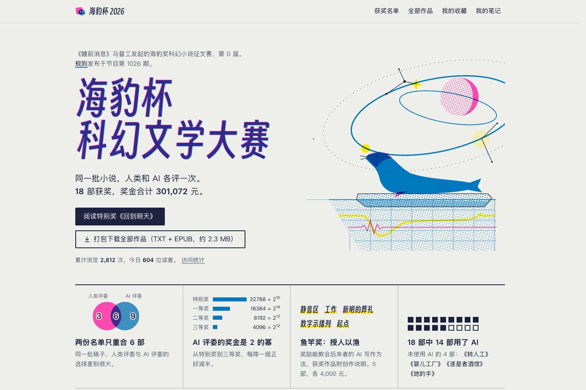

# 海豹杯 2026 获奖作品站

**👉 https://scifi.ironieser.cc**

《睡前消息》马督工发起的海豹奖科幻小说征文赛（第 0 届）获奖作品集。同一批小说，人类评委和 AI 评委各评一次：18 部获奖作品，奖金合计 301,072 元。

在这里可以：

- 看获奖名单：人类评委奖、AI 评委奖、鱼竿奖，以及两份名单的对照
- 在线阅读全部 18 部作品，字号、字体、背景随意调，自动记住读到哪
- 划线、写笔记；被很多人划过的句子，所有读者都能看到「N 人划线」
- 下载 TXT / EPUB，或一次打包全部作品
- 点赞、收藏、评论，分享到微信 / 微博 / QQ，生成金句分享图
- 看督工在颁奖节目里对作品的点评，一键跳到视频对应时间点
- 看全站访问统计和作品阅读排行

规则见《睡前消息》第 1026 期，颁奖与点评见第 1130 期。

觉得有用，欢迎点个 ⭐ Star。发现错字、排版问题或有建议，欢迎提 Issue，或写信给 ironieser@gmail.com。

## 版权

代码与原创插画采用 MIT 许可；获奖小说正文与创作说明版权归各作品作者所有；节目点评摘要引自《睡前消息》第 1130 期。
